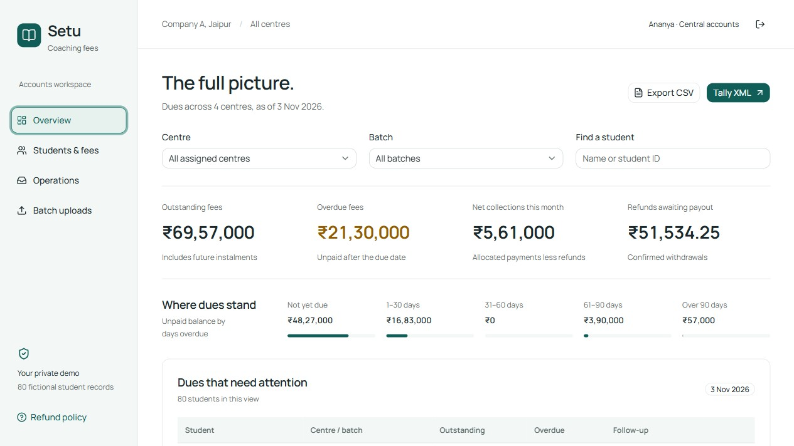

Repository: [github.com/Het-Jethva/setu-coaching-fees-task5](https://github.com/Het-Jethva/setu-coaching-fees-task5)
Live demo: [setu-coaching-fees-task5.vercel.app](https://setu-coaching-fees-task5.vercel.app)

# Setu coaching fees
Technical Design Document | Isocode Task 5 | 3 November 2026

## The problem and the delivered product
Company A's four Jaipur centres keep fee dates in spreadsheets, record receipts separately, and follow up by phone. Parents need a clear balance and due date; accounts staff need a consistent view across centres. Setu brings those tasks into one database-backed application.

The submission implements every must-have, including the optional depth beyond the required core. It has two roles: parent and accounts executive. Accounts executives also handle the internal counsellor queue in this demo.

| Workflow | Delivered behaviour |
| --- | --- |
| Student ledger | Three/four instalments, fixed discounts, partial payments, GST receipts, balance, overdue days, visible reversals and protected plan revisions. |
| Parent portal | Expiring OTP, recorded consent, linked children, Hindi/English dues and pay links, receipts, attendance and test results. |
| Collections | Daily reminder stages, immediate cancellation on full payment, unmatched-payment queue and explicit allocation. |
| Accounts | Centre/batch filters, ledger-derived metrics, ageing, withdrawal preview, refund obligation and separate payout. |
| Academic records | Batch CSV templates, row errors, preview, atomic confirmation and parent visibility. |
| AI and exports | Hosted free-model risk review, dismissible call tasks, Tally voucher XML and readable CSV. |

## Review it in a few minutes
Open the live demo, choose Accounts executive and Central accounts, and use the displayed demo password SetuDemo2026!. For the parent journey, request an OTP for PARENT-01 and use the visible demo inbox. Record consent, switch to Hindi, pay Ishita's remaining INR 15,000 in mock checkout, then inspect the same workspace from Accounts.

Each browser starts an isolated workspace with 80 fictional students, four centres and eight batches. The three supplied sample students retain their IDs, names, amounts and dates. Relative overdue labels use the current India date. Workspace records expire after 48 hours.

The brief's targets of halving late collections, reducing dues calls by 70%, and reducing reconciliation to one day are success criteria for a future rollout. This assignment does not claim measured savings or predictive accuracy.

---PAGE---

## Architecture and ownership
One Next.js 16 application contains React views, TypeScript route handlers and PostgreSQL access. Vercel runs the personal demo; Neon Free stores its data. shadcn/ui with Base UI provides controls. SWR refreshes authenticated snapshots after commands. Self-hosted fonts avoid a third-party font request.

{{architecture}}

Route handlers parse Zod inputs and derive the actor from the server session. The access module enforces workspace, centre and parent-child scope. Pure domain functions calculate balances, dates, GST and refunds. The enrollment module owns live financial changes and reminder eligibility; the AI module has no money-writing or messaging interface.

| Data group | Storage and relationships |
| --- | --- |
| Workspace and people | Workspace-scoped parents, staff and students. Students link to a parent, centre and batch. Sessions and OTP challenges link to people. |
| Fee plan | A validated plan snapshot on the student: gross fee, discount, tax basis points, course dates and instalments. Plan revisions retain before/after snapshots. |
| Money | Immutable receipt rows and append-only ledger events: allocation, reversal, withdrawal and payout. Events link to their student and original operation. |
| Operations | Expiring checkouts and uniquely keyed reminder stages per instalment. Receipt references are unique within a workspace. |
| Academics | Attendance keyed by student/date; tests keyed by student/name/date. Persistent import previews expire after 30 minutes. |
| Review and audit | Risk assessments keyed by evidence hash, associated call tasks, durable AI attempts, consent events and authentication attempts. |

## Why this shape
A full general ledger would require account setup and posting rules beyond this fee-management task. A narrow enrollment journal preserves money history and supports consistent balances without replacing Tally. Operational tables remain relational; small plan/event payloads use validated JSONB. There is no writable balance cache or separate projection worker to drift from the journal.

Financial commands lock one student row before reading and appending facts. Messages are mock database records, so the final eligibility check and recording a send occur under that same lock. External model calls happen outside database transactions. A real gateway or messaging provider would require a durable outbox, signed callbacks and reconciliation.

---PAGE---

## Money rules and the payment flow
All stored money is integer paise. The demo fee includes GST at a configurable 18% assumption. A fixed discount reduces the total before splitting it into three or four instalments. Remainder paise go to the first instalments, so the schedule always sums to the agreed total. The fee-plan editor works only before any receipt or financial event; revisions invalidate pending links and rebuild reminder stages.

Payment flow: select an instalment and amount, create a 20-minute checkout, simulate success/failure/pending, then refresh the ledger. Success creates one immutable receipt and allocates only up to the selected instalment's latest balance. Any excess remains unmatched. Failed and pending outcomes never settle money. Repeated success callbacks return the same receipt.

Staff allocate unmatched money explicitly. The server checks both remaining receipt value and instalment balance while holding the student lock. Posted allocations and payouts are corrected by linked reversals; original facts stay visible. A refunded allocation cannot be reversed until its payout is reversed. Reversing an active payment reopens unsent reminder stages for the restored balance.

## Withdrawal and refund settlement
The published demo policy uses calendar days and counts the withdrawal day as used. Dates are clamped to the course period. There is no extra cancellation charge or late fee.

| Calculation | Rule |
| --- | --- |
| Agreed course fee | Gross GST-inclusive fee minus fixed discount. |
| Earned fee | Agreed fee multiplied by used days / total course days, rounded to paise. |
| Refund available | Collected allocations minus earned fee minus active payouts, never below zero. |
| Unpaid earned fee | Earned fee minus collected allocations, never below zero. |
| Refund deadline | Withdrawal date plus 10 calendar days. |

Example: an INR 1,20,000 course lasting 100 days earns INR 30,000 after 25 used days. If INR 60,000 has been collected, INR 30,000 is refundable. If only INR 20,000 has been collected, no refund is due and INR 10,000 remains owed. Unearned fees are cancelled in both cases.

Staff first preview the calculation and its ledger-version hash. Confirmation rejects a stale preview if payments or the plan changed. One withdrawal event fixes the earned amount and deadline; repeated confirmation does not create another obligation. Record refund paid is a separate mock payout with an operation ID and a refundable-balance cap.

## Dashboard definitions
Outstanding includes future unpaid charges; overdue includes only unpaid charges past their due date. Ageing groups use each remaining balance: not yet due, 1-30, 31-60, 61-90 and over 90 days. Net collections this month means allocations less reversals and active refund payouts. Unallocated receipts remain visible separately. These figures describe fee settlement; the export separately represents cash received.

---PAGE---

## Interface decisions
The parent home reads like a fee statement: child, amount due, due date, overdue state and Pay. Academic records and receipts follow in tabs. The accounts workspace uses a stable rail, compact filters, one open metrics row, ageing bars and a sortable-by-priority student list. Exceptions have explicit queues.

{{phone}}

The original Setu identity uses white, deep teal actions, dark ink and restrained amber for attention. Manrope and Noto Sans Devanagari are bundled locally. Money uses tabular numerals. Shared shadcn fields, native selects, tables and dialogs keep forms and keyboard behaviour consistent.

Phone layouts were inspected at 390 x 844 in English and Hindi. The page fits the viewport; dense tables scroll within their region. Loading, empty, failure, pending and completed states use the same components. A final review found insufficient contrast in inactive tabs; the corrected muted text exceeds 4.5:1 against its surface.

---PAGE---

## Daily reminders and academic imports
Reminder stages are created at seven days before, on the due date, and three, seven and fourteen days after. The daily worker uses the parent's current language and checks consent, withdrawal and current balance before recording a message. Full payment cancels pending stages immediately; partial payments leave reminders active for the remainder.

When stages have accumulated before the first demo run, the worker sends the latest eligible stage and marks older unsent stages skipped. It does not flood the inbox with every historical reminder. Unique stage IDs and student locking make retries safe. Withdrawing consent blocks sends; withdrawing from the course cancels them.

The production cron invokes /api/cron once daily in the 09:00 IST scheduling hour. A Bearer secret protects it. The Operations screen provides the same worker on demand so reviewers can inspect behaviour immediately. Vercel Hobby scheduling is daily, not an exact-minute delivery guarantee.

| CSV kind | Columns |
| --- | --- |
| Attendance | student_id, date, status (present or absent). |
| Test results | student_id, test_name, date, marks, maximum_marks. |

Staff choose an assigned batch and download its template. The preview validates headers, dates, membership, marks ranges and duplicates, showing row-level errors. An invalid file cannot be confirmed. Confirmation checks the data again under a batch transaction, then commits every row together. Identical repeats are idempotent; conflicting duplicates are rejected. Parents see imported records after refresh.

## Tally and receipts
Printable receipts show the received amount, current allocation, unmatched value and GST-inclusive base/tax split. They are labelled synthetic demo receipts, not a statutory tax invoice.

Tally XML exports balanced Receipt/Payment vouchers for received money and active refund payouts. Stable voucher identifiers, configured bank/fee-ledger names, escaped content and a matching CSV support review. The export does not supply a full chart of accounts, GST tax-ledger mapping, or credit-note workflow. TallyPrime import must be tested in a disposable company before client use; no live Tally installation was available here.

## Authentication and consent
Parent OTPs expire in five minutes, allow five attempts and are hashed in storage. Demo delivery deliberately exposes the code in a labelled inbox. Server sessions use random hashed tokens and secure HTTP-only SameSite cookies in production. Staff sign-in and OTP requests have durable rate limits; mutation requests require the application Origin. Parent records remain hidden until a versioned consent decision is recorded. This demonstrates the workflow; real identity and parental verification require a production integration.

---PAGE---

## Hosted AI with a narrow job
The selected model is nvidia/nemotron-3.5-super-vl:free through OpenRouter. Its free structured-output endpoint was checked and actual inference was tested locally and on the deployed app. This is an advisory dropout-risk flag, not a trained or validated prediction for this institute.

Accounts staff assess a batch of up to ten students on demand. Eligible records need at least five attendance observations in each of two preceding 14-day periods and at least three tests. Withdrawn students and insufficient histories remain not assessed. Inputs contain only invented anonymous fee and academic summaries: missed instalment count, maximum lateness, attendance percentages and recent test percentages. Names, contacts and student IDs are omitted from the provider request; temporary response IDs map back on the server.

## Request and validation boundary
The server computes which supporting signals the evidence permits: missed payments, falling attendance and falling test scores. The model returns a strict object containing one risk level and permitted signal codes per requested record. The server rejects malformed JSON, duplicate/unknown/missing records, unsupported signals and a high-risk answer without evidence before persisting results.

Only validated high risk creates an internal call task. Staff can mark a false flag. The model cannot allocate money, alter fees, record refunds, or message parents. Review reasons are server-written descriptions of validated signal codes rather than unrestricted model prose.

| Operational choice | Behaviour |
| --- | --- |
| Cost control | Free model and Nvidia provider allowlist; all price caps zero; no paid fallback. |
| Quotas | Five attempts per workspace, forty app-wide per UTC day and ten app-wide per minute. Failed requests count. |
| Cache | Hash of evidence, model and policy reuses an unchanged assessment and preserves dismissal. |
| Failure | Missing key, timeout, provider/quota failure or invalid evidence shows unavailable/not assessed. It never becomes a low-risk guess. |
| Reasoning budget | Reasoning disabled for this structured classification to avoid exhausting the output budget before JSON. |

During live testing the provider first exhausted its output budget, then returned unsupported evidence for a steady-performing record. Both were treated as failures. Disabling optional reasoning and constraining each record's permitted signals resolved the request path. Captured invalid output is a regression test. The final hosted run persisted ten assessments, created five high-risk results and verified cache reuse and dismissal without changing plans, receipts or financial events.

Free-provider availability can change. Anonymous synthetic inputs are intentional because free-model provider handling is unsuitable for undisclosed real student data. A real rollout needs provider/privacy review and an evaluated labelled dataset before staff rely on risk quality.

---PAGE---

## Verification and delivery
The public repository contains the source, schema, seed, domain tests and repeatable HTTP verification scripts. Meaningful commits separate the requirements, implementation and deployment hardening. The deployment guide includes setup commands, environment variable names, reviewer logins, Tally test steps and demo limitations.

| Check | Evidence |
| --- | --- |
| Build quality | TypeScript check, ESLint, optimized Next.js production build and 12 domain/AI-validation tests pass. |
| Money and dates | Tests cover split conservation, GST rounding, refund bounds, earned unpaid fees, reversals, reporting and calendar boundaries. |
| Live API | Local and hosted scripts pass payment/refund retries, stale quotes, allocation caps, role/centre/workspace scope, consent, Hindi reminders, atomic CSV imports, receipts and exports. |
| Additional regression | Four-instalment discounted revision, protection after money, and resuming unsent reminders after a payment reversal pass against PostgreSQL. |
| Real AI | Local and production free-provider calls persist validated results; cache, dismissal and unchanged financial records were checked. |
| Browser | Parent OTP, consent, Hindi/English phone views, mock payment and receipt journey inspected; production fee-plan editor exercised. |
| Local setup | Fresh Docker Compose PostgreSQL database migrated and full API script passed. Runtime dependency audit reports no known vulnerabilities at verification time. |

## Hosting and operating limits
Vercel Hobby and Neon Free host this personal assignment demo. Functions and database are configured for Singapore. Secrets are server-side environment values and excluded from Git and the submission. Workspaces isolate reviewers and expire after 48 hours. The daily protected job records mock sends and removes expired workspaces. This is a small review environment, not a load-tested 2,600-student production service.

---PAGE---

## Assumptions, cuts and next work
All must-haves are present. Payments, OTP/SMS delivery, reminder delivery, refund payouts and outside connections are explicitly mocked, as the core brief permits. The database workflows remain real. The 18% GST-inclusive fee, calendar-day refund formula, no late fee, fixed discount, reminder offsets, centre/batch naming and synthetic history are documented assumptions approved for the assignment.

Before client rollout: validate tax/refund policy and consent requirements; integrate a signed gateway and message outbox; add verified parental identity; certify Tally mappings; establish backup/restore, retention, audit access and monitoring; move reminder processing to paginated durable work; load-test real centre volumes; evaluate model accuracy and fairness with reviewed labels. The current scheduler handles at most 100 active demo workspaces per invocation and has a serverless time limit, so it is not the production scale design.

No lectures, timetable or admissions CRM was built, matching the brief's exclusions. The submission ZIP contains exactly this PDF and deployment.md. Repository and live links remain at the top for immediate review.

## Primary implementation references
[Next.js documentation](https://nextjs.org/docs), [shadcn/ui](https://ui.shadcn.com/docs), [OpenRouter model](https://openrouter.ai/nvidia/nemotron-3.5-super-vl:free), [OpenRouter provider routing](https://openrouter.ai/docs/guides/routing/provider-selection), [Vercel cron limits](https://vercel.com/docs/cron-jobs/usage-and-pricing), [Neon plans](https://neon.com/docs/introduction/plans), [Tally sample XML](https://help.tallysolutions.com/sample-xml/).
